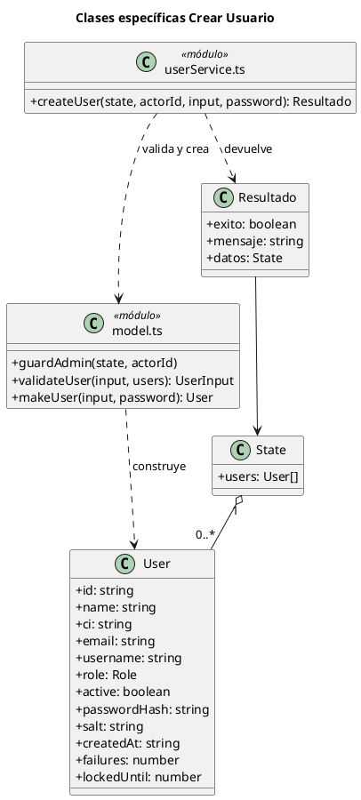
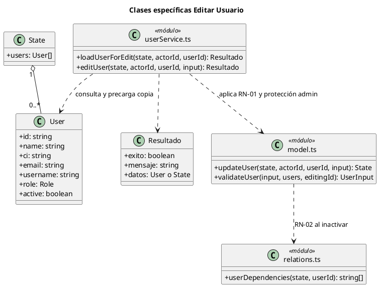
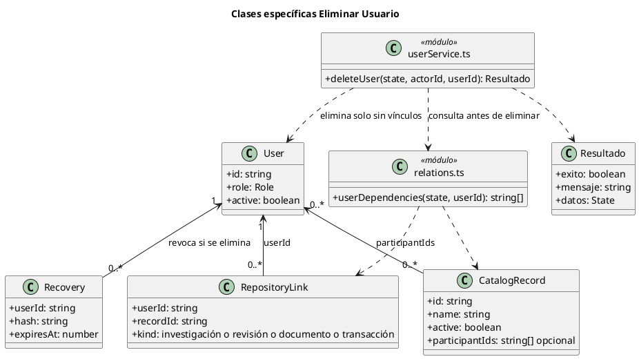
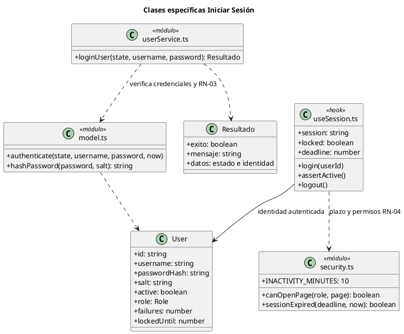
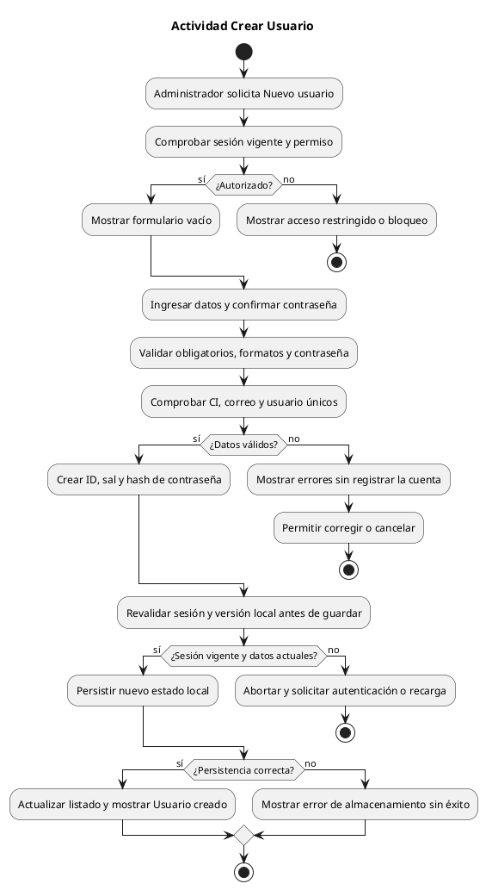
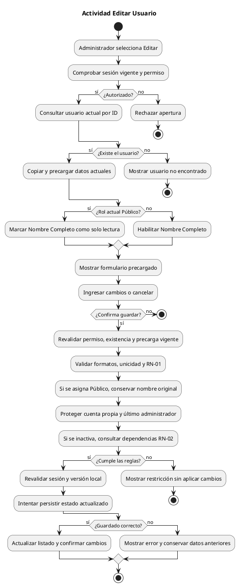

# Mantenimiento de usuarios y autenticación

Grupo 2 · Sistema de Repositorio de Investigaciones

Ingeniería de Software I · Guía iniciada el 8/10; texto consolidado al 17/10/2026

Grupo 2 presenta la actualización del mantenimiento de usuarios y de los controles locales de autenticación y acceso para Ingeniería de Software I. El documento vincula reglas, casos de uso, diagramas y pruebas para explicar el funcionamiento ante la mesa examinadora.

El cliente conserva React/TypeScript y el backend simulado: metadatos en localStorage, binarios en IndexedDB y una cuenta/sesión compartida entre pestañas del mismo navegador/origen. El servidor separado ya implementa PostgreSQL, JWT, cookies HttpOnly, correo y auditoría; falta el transporte HTTP del cliente. Los controles del simulador no ofrecen seguridad frente a manipulación del navegador. La guía vigente de servicios, plazos, versiones y confirmación es [ADAPTACIONES-CLIENTE.md](../ADAPTACIONES-CLIENTE.md).

Los diagramas incrustados y las copias PlantUML/SVG, junto con FCEA-Usuarios-Seguridad.docx, se conservan como modelos históricos del hito original del 8/10; no describen la fachada asíncrona ni la sesión compartida añadidas el 17/10. Los elementos marcados módulo o hook representan funciones de TypeScript, no clases orientadas a objetos que deban existir literalmente en el código. User y State representan el almacenamiento privado del simulador; las pantallas actuales reciben DTO/ViewState mediante DataProvider y no credenciales ni State completo.

## Reglas y alcance

Altas: confirmación visual sin segunda contraseña. Modificaciones, estados y bajas: contraseña actual del actor; tres fallos cierran la sesión compartida. Las escrituras conservan la versión leída y un conflicto 412 exige revisión. Cancelar no guarda. Los flujos siguientes describen las reglas de negocio del simulador; los diagramas mantienen sus llamadas originales como antecedente.

RN-01 — El nombre de la cuenta Público es de solo lectura en edición administrativa y Mi perfil. También se rechaza su cambio en la lógica de negocio. Un cambio de rol en el mismo guardado no permite eludir la restricción.

En **Mi perfil**, el nombre completo de Digitador también es de solo lectura y su modificación se rechaza en `editProfile`, incluso si se altera el formulario. Digitador conserva la edición de correo y nombre de usuario. Administrador puede cambiar su propio nombre y editar el nombre de una cuenta Digitador desde Usuarios. Esta ampliación es local al frontend y no cambia el contrato de la API.

RN-02 — Tanto eliminar como pasar de Activo a Inactivo requieren ausencia de vínculos. Se consultan las relaciones registradas y todos los participantes históricos de catálogos. Un registro anterior sin trazabilidad impide la baja cautelarmente, sin inventar su propietario.

RN-03 — La condición de cuenta inactiva se comunica después de verificar correctamente la contraseña. Las credenciales erróneas mantienen el mensaje genérico. Un bloqueo temporal vigente tiene prioridad.

RN-04 — La apertura por URL aplica la matriz de permisos, con denegación por defecto. La sesión se bloquea a los 10 minutos sin actividad, según la elección del grupo. El plazo se conserva al recargar y se revisa al regresar a la pestaña; una interacción posterior al vencimiento no lo renueva.

## CU01 Crear Usuario

**Actores:** Administrador autenticado. El sistema actúa como participante secundario.

**Precondiciones:** Sesión vigente y rol Administrador. Almacenamiento local disponible. El nombre se captura libremente al crear, incluso para Público; RN-01 rige en la edición.

**Flujo principal**

1. El administrador abre Usuarios y selecciona Nuevo usuario. El sistema comprueba el permiso de apertura.
2. El sistema muestra el formulario vacío con nombre, CI, correo, usuario, rol, estado, contraseña y confirmación.
3. El administrador completa los datos y confirma Crear usuario.
4. El servicio comprueba permiso, campos obligatorios, formatos, unicidad de CI/correo/usuario y política de contraseña.
5. El modelo genera identificador, sal aleatoria y hash; el sistema revalida sesión y versión de los datos antes de persistir.
6. Al guardar correctamente, el sistema cierra el formulario, actualiza el listado y confirma la creación.

**Flujos alternativos y excepciones**

- A1 Datos inválidos, duplicados o contraseñas diferentes: mostrar el motivo, conservar el formulario y no crear la cuenta.
- A2 Sin permiso o sesión vencida: impedir la operación; si venció por inactividad, solicitar autenticación.
- A3 Cancelar: cerrar el formulario sin cambios.
- E1 Error de almacenamiento o datos cambiados en otra operación: no informar éxito; mostrar error y solicitar reintento o reapertura.

**Postcondiciones:** Éxito: una cuenta nueva persistida con contraseña derivada, sin contraseña en texto plano. Rechazo: no se agrega la cuenta.

> **Espacio reservado para captura de interfaz**
>
> Insertar captura de Usuarios → Nuevo usuario con datos ficticios y sin contraseñas visibles.

### Diagrama de clases específico

## CU02 Editar Usuario

**Actores:** Administrador autenticado.

**Precondiciones:** Sesión vigente, permiso de usuarios y cuenta destino existente. Se consulta el usuario por ID antes de abrir el formulario.

**Flujo principal**

1. El administrador selecciona Editar en el listado.
2. loadUserForEdit comprueba el permiso, consulta la cuenta actual y entrega una copia para precargar los campos.
3. El sistema despliega el formulario precargado. Si el rol actual es Público, Nombre Completo se muestra de solo lectura.
4. El administrador modifica los campos permitidos y confirma Guardar cambios. Si asigna Público a otra cuenta, se conserva el nombre original.
5. El servicio revalida la precarga, formatos, unicidad, RN-01, cuenta propia y último administrador. Para inactivar, verifica RN-02.
6. Se revalida la sesión, se persiste el estado y se actualiza el listado con un mensaje de confirmación.

**Flujos alternativos y excepciones**

- A1 Cuenta inexistente o precarga desactualizada: no aplicar cambios; pedir volver al listado y abrir nuevamente.
- A2 Intento de modificar nombre Público, incluso alterando el formulario: rechazar con mensaje de solo lectura.
- A3 Campos inválidos, duplicados, baja con dependencias o protección de administrador: explicar la restricción y conservar datos.
- A4 Cancelación, falta de permiso, sesión vencida o fallo al guardar: no confirmar actualización.

**Postcondiciones:** Éxito: se mantienen ID, credencial y fecha de creación; solo cambian los campos autorizados. Rechazo: no se aplica la modificación.

> **Espacio reservado para captura de interfaz**
>
> Insertar captura de Editar usuario con rol Público y Nombre Completo de solo lectura.

### Diagrama de clases específico

## CU03 Eliminar Usuario

**Actores:** Administrador autenticado.

**Precondiciones:** Sesión vigente, usuario destino existente y distinto del administrador que opera. La ausencia de dependencias debe comprobarse al confirmar.

**Flujo principal**

1. El administrador selecciona Eliminar y el sistema muestra el nombre de la cuenta y la advertencia de eliminación definitiva.
2. El administrador confirma Eliminar definitivamente.
3. El servicio vuelve a comprobar permiso, existencia, cuenta propia y permanencia de al menos un administrador activo.
4. El sistema consulta relaciones de investigaciones, revisiones, documentos y transacciones registradas, y participantes de todos los catálogos, activos o inactivos.
5. Solo si no existen vínculos ni trazabilidad desconocida, elimina la cuenta y sus recuperaciones pendientes del nuevo estado.
6. Se revalida la sesión y se persiste el resultado. El listado se actualiza y se confirma la eliminación.

**Flujos alternativos y excepciones**

- A1 Existen relaciones: abortar y mostrar «No se puede eliminar el usuario: tiene registros o transacciones asociados», con el detalle disponible.
- A2 Catálogo antiguo sin participantes registrados: bloquear cautelarmente, indicando que no se puede descartar una relación.
- A3 Cuenta propia, último administrador, usuario inexistente o falta de permiso: rechazar.
- A4 Cancelación, sesión vencida o error de persistencia: no eliminar ni informar éxito.

**Postcondiciones:** Éxito: la cuenta sin vínculos deja de existir y sus tokens de recuperación se revocan. Rechazo: cuenta, relaciones y credenciales se conservan.

> **Espacio reservado para captura de interfaz**
>
> Insertar captura del diálogo Eliminar usuario y, si corresponde, del mensaje que impide la operación por dependencias.

### Diagrama de clases específico

## CU04 Iniciar Sesión

**Actores:** Usuario registrado de cualquier rol. También aplica a la reautenticación después del bloqueo por inactividad.

**Precondiciones:** Cuenta registrada y almacenamiento accesible. El usuario está en la pantalla de ingreso o en la pantalla de sesión bloqueada.

**Flujo principal**

1. El usuario ingresa su nombre de usuario y contraseña y selecciona Iniciar sesión.
2. El sistema valida los campos y busca la cuenta usando el nombre de usuario normalizado.
3. Comprueba si existe un bloqueo temporal por intentos fallidos y verifica el hash de la contraseña.
4. Con credenciales válidas, verifica que la cuenta esté activa; si está inactiva, aplica RN-03 y no crea sesión.
5. Con cuenta activa, restablece el contador de fallos y persiste el estado. Guarda la sesión compartida por navegador/origen, con máximo de siete días y diez minutos de inactividad. Restaurar o consultar la sesión no renueva actividad.
6. Abre Inicio con las opciones del rol. En una reautenticación, vuelve a la página anterior previa verificación de permisos.

**Flujos alternativos y excepciones**

- A1 Credenciales incorrectas: mensaje genérico; incrementar fallos de la cuenta encontrada. Tres fallos consecutivos bloquean por 5 minutos.
- A2 Cuenta inactiva con contraseña válida: «Tu cuenta se encuentra inactiva. Contacta con el administrador».
- A3 Bloqueo temporal vigente: informar y no crear sesión, aun con contraseña correcta.
- A4 Tras 10 minutos sin actividad: ocultar páginas privadas y pedir la contraseña de la misma cuenta; Cerrar sesión permite ingresar con otra.
- E1 Error de lectura, escritura o criptografía: mostrar error legible, sin abrir una sesión autenticada.

**Postcondiciones:** Éxito: sesión compartida vigente, con inactividad de 10 minutos renovable solo por interacción y vencimiento absoluto de siete días. Rechazo: sin acceso privado; pueden persistirse los intentos fallidos.

> **Espacio reservado para captura de interfaz**
>
> Insertar captura del login o del mensaje de cuenta inactiva, sin mostrar la contraseña.

### Diagrama de clases específico

## actividad crear usuario

## actividad editar usuario

## Organización del código

UserPages.tsx contiene mantenimiento, perfil y contraseña. AuthPage.tsx presenta login y recuperación. userService.ts expone resultados { exito, mensaje, datos } y captura errores de negocio. model.ts contiene validaciones y derivación de contraseñas. relations.ts consulta dependencias. security.ts define permisos y tiempo. useSession.ts controla bloqueo y reautenticación. storage.ts conserva y migra datos anteriores.

App.tsx compone el DataProvider y el adaptador mock; las pantallas usan servicios asíncronos por dominio. La persistencia del estado privado y su auditoría se confirma conjuntamente en el adaptador. Antes de guardar se comprueba que el estado local no haya cambiado desde el inicio de la operación; un fallo no produce un mensaje de éxito. Esta comprobación es defensiva, no una transacción de base de datos entre pestañas.

La sesión vigente continúa al cambiar la contraseña personal. La recuperación local revoca tokens previos; el enlace de demostración vence a los 15 minutos. El bloqueo por intentos fallidos dura 5 minutos, independientemente de los 10 minutos de inactividad.

Publicaciones, archivos y reportes ya tienen pantallas operativas. RepositoryLink conserva compatibilidad con referencias históricas; publicaciones y adjuntos reales del simulador también participan en la comprobación de vínculos. No existe un flujo de evaluación académica dentro del repositorio. Los catálogos existentes sí incorporan los identificadores de quienes los crean o modifican; estos participantes se conservan aunque cambie el último editor.

## Guía de validación y defensa

- Pruebas automatizadas: ejecutar npm test. Cubren precarga, RN-01 administrativa y personal, permisos, creación y unicidad, eliminación con y sin relaciones, conservación de participantes, migración, login inactivo, cambios de contraseña, recuperación y límites de inactividad.

- Verificación de interfaz: ingresar como admin, abrir Usuarios y editar publico; el nombre aparece precargado y no editable. Abrir la URL #usuarios con Público debe mostrar Acceso restringido.

- Verificación de eliminación: en un entorno de prueba, crear una cuenta sin relaciones y eliminarla. Después, crear un autor como digitador y comprobar como admin que no se puede eliminar ni inactivar esa cuenta. La instalación nueva incluye muestras demo; para este ensayo crear identidades adicionales sin vínculos y conservar los datos anteriores.

- Verificación de inactividad: iniciar sesión, dejar la pestaña sin teclado, clics, desplazamiento ni interacción táctil durante 10 minutos. Debe aparecer Sesión bloqueada por inactividad. Recargar no debe desbloquear. Una contraseña errónea tampoco; la correcta permite continuar.

- Cuentas iniciales ficticias en un navegador sin datos anteriores: admin, digitador y publico; contraseña inicial compartida Fcea2026!. Si ya se cambió alguna contraseña, se conserva la nueva. No borrar datos existentes para probar la migración.

## Estado del servidor y conexión pendiente

El servidor implementa permisos/RN-01, comprobación de vínculos bajo bloqueo, FKs RESTRICT, Argon2id, sesiones verificables, expiración/revocación, recuperación por correo y auditoría inmutable. H2 comprueba publicaciones creadas, archivos propios y participación histórica en catálogos existentes antes de inactivar; DELETE añade las referencias de sesiones/auditoría. Los contratos están en [API.md](../../../server/docs/API.md) y [CLIENT-INTEGRATION.md](../../../server/docs/CLIENT-INTEGRATION.md).

Publicaciones y reportes están implementados en ambos proyectos. Falta el adaptador HTTP con cookies/Bearer, confirmación y versiones, además de la validación completa desde navegador. El hash local no es una credencial del servidor ni debe migrarse a producción.

Datos de carátula que debe completar el grupo antes de entregar: nombres y apellidos de integrantes. No se incluyen nombres no confirmados.

Referencia de sintaxis: [documentación oficial de PlantUML](https://plantuml.com/class-diagram). Los seis diagramas se validaron con el renderizador de PlantUML y se incluyen también en formato SVG.
